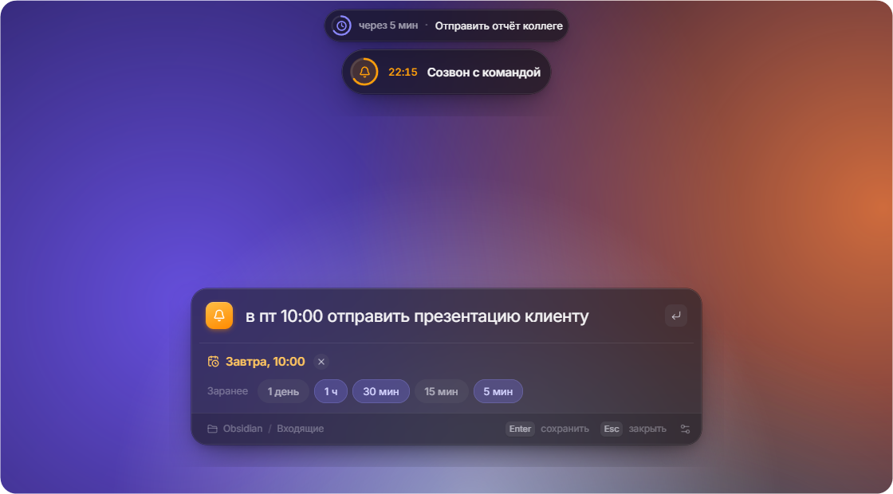
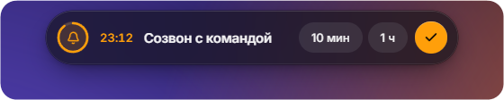
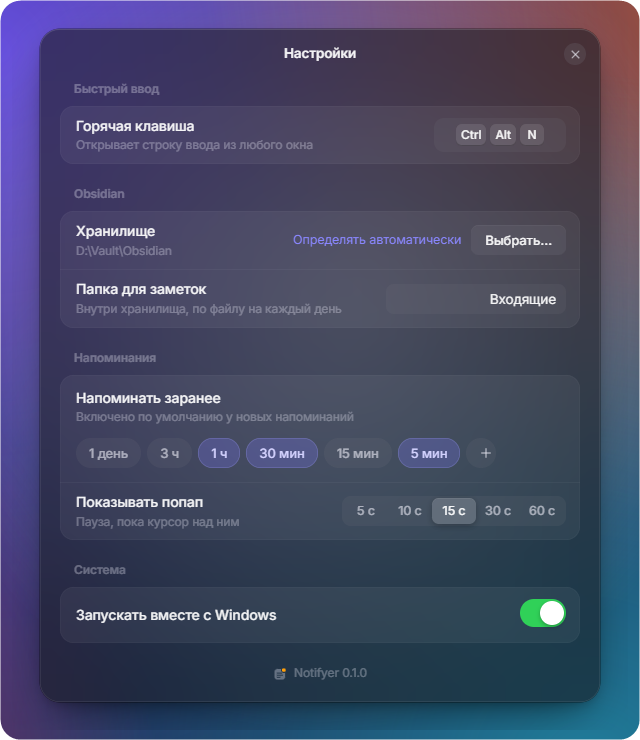

<div align="center">


# Notifyer

**Мысль — в Obsidian за секунду. Напоминания — поверх всех окон.**

<br />

[](https://github.com/FKNGMayer/Notifyer/releases/latest/download/Notifyer-setup.exe)
[](https://github.com/FKNGMayer/Notifyer/releases/latest/download/Notifyer.dmg)

<sub>Windows 11 · macOS (Apple Silicon и Intel) · <a href="https://github.com/FKNGMayer/Notifyer/releases">все версии</a></sub>

<br />
<br />



</div>

<br />

## Записать мысль

<kbd>Ctrl</kbd> <kbd>Alt</kbd> <kbd>N</kbd> (на Mac <kbd>⌃</kbd> <kbd>⌥</kbd> <kbd>N</kbd>) из любого окна → пишешь → <kbd>Enter</kbd>.

Строка с временем уходит в `Входящие/ГГГГ-ММ-ДД.md` твоего хранилища Obsidian. Сам Obsidian может быть закрыт, а с Obsidian Sync запись сразу появится и на телефоне.

## Напоминания обычным текстом

Если во фразе есть дата, Notifyer её поймёт и напомнит.

| Пишешь | Напомнит |
| :-- | :-- |
| `завтра в 15 созвон с командой` | завтра в 15:00 |
| `в пт 10:00 отправить отчёт клиенту` | в пятницу в 10:00 |
| `через 2 часа позвонить коллеге` | через 2 часа |
| `25 декабря в 7 вечера корпоратив` | 25 декабря в 19:00 |
| `20.11 продлить домен` | 20 ноября в 9:00 |

Заранее — за час, 30 и 5 минут. Набор меняется прямо в строке ввода или раз и навсегда в настройках.
В хранилище напоминание ложится задачей: `- [ ] Созвон с командой ⏰ 2026-11-20 15:00`.

## Остров



Напоминание выезжает сверху экрана поверх всех окон. На Mac с вырезом камеры остров вырастает прямо из выреза, как Dynamic Island. Наведи курсор — отсчёт встанет на паузу, появятся «10 мин», «1 ч» и ✓. Клик по острову — готово.
Предупреждения заранее маленькие и не отвлекают. Пропущенное, пока компьютер был выключен, покажется при включении.

## Настройки



Горячая клавиша — просто нажми нужное сочетание.

Хранилище Obsidian находится само, папку для заметок можно поменять.

Напоминания по умолчанию, время показа острова, автозапуск.

Всё применяется сразу.

<br clear="right" />

## Для Stream Deck и скриптов

```
Notifyer.exe --add "завтра в 10 стрим"     сохранить без окна
Notifyer.exe --new "текст"                 открыть строку с текстом
Notifyer.exe --settings                    открыть настройки
```

На Mac то же самое через `/Applications/Notifyer.app/Contents/MacOS/Notifyer --add "…"`.

<br />

---

<sub>Приложение не подписано сертификатом. Windows SmartScreen при первом запуске может попросить подтверждение. На Mac перетащи Notifyer в «Программы», открой его, а когда macOS откажется запускать, нажми «Всё равно открыть» в «Системные настройки → Конфиденциальность и безопасность». Если вместо этого пишет, что приложение повреждено, выполни в Терминале `xattr -dr com.apple.quarantine /Applications/Notifyer.app`. Лицензия [MIT](LICENSE).</sub>
